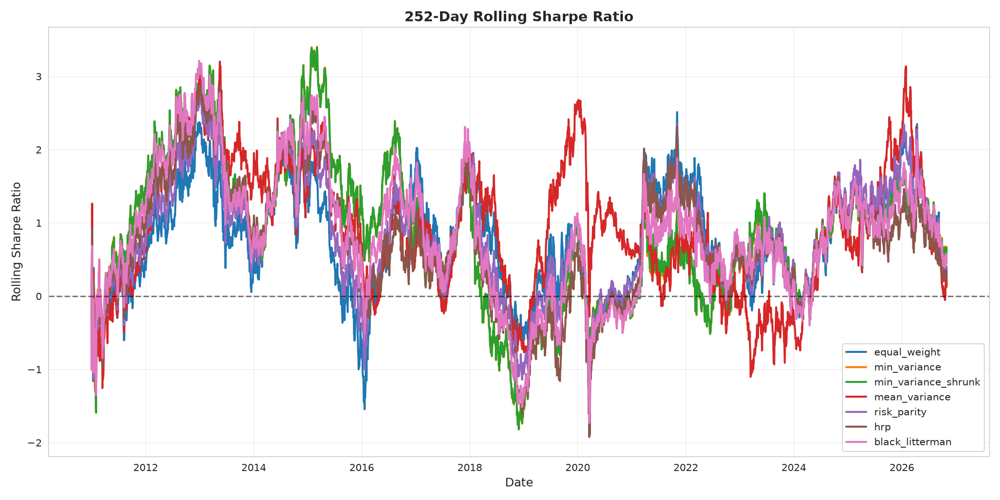

# JSE Top-40 Portfolio Optimiser Lab

**Author:** Tjay Burger  
**GitHub:** [Tjay-cmd](https://github.com/Tjay-cmd)

## Research Question

Which portfolio construction method delivers the best out-of-sample risk-adjusted returns on JSE equities after accounting for transaction costs, turnover, and ZAR exchange rate risk?

## Key Findings

1. **Mean-Variance optimization achieved the highest return (15.84%) but with proportionally higher risk (22.24% vol)** and significantly higher turnover (22.03%). While its Deflated Sharpe Ratio of 0.69 is the highest among strategies tested, this represents promising but not definitively proven outperformance.

2. **Equal Weight (1/N) outperformed the passive benchmark** with 9.89% return vs 8.64% for STX40, while maintaining lower turnover (3.26%) and comparable volatility. This confirms the findings of DeMiguel et al. (2009).

3. **Deflated Sharpe Ratio correctly penalizes for multiple testing**: When testing 7 strategies, even good Sharpe ratios receive DSR < 0.7. The DSR represents the probability that the true Sharpe ratio exceeds the expected maximum Sharpe from luck alone across N trials, accounting for selection bias.

4. **Transaction costs significantly impact high-turnover strategies**: Mean-Variance's elevated turnover leads to measurable cost drag that must be considered in implementation.

5. **Hierarchical Risk Parity underperformed** with DSR 0.18, suggesting potential overfitting despite its theoretical appeal.

## Methodology

### Universe

JSE Top-40 constituent equities, sourced via yfinance with `.JO` suffix. The configuration lists **34 tickers** after removing duplicates. The backtest uses an **unbalanced panel**: stocks enter the universe once they have sufficient trading history (252 days), allowing the sample to span multiple market regimes rather than truncating to the latest listing date.

### Sample Period

**Data range:** 2010-01-04 to 2026-10-30 (4,289 trading days)  
**Evaluation period:** 2010-12-31 to 2026-10-30 (from first allocation date, ~16 years)

This period captures:
- The 2015-2016 commodity downturn
- The 2020 COVID-19 crash and recovery
- Multiple ZAR volatility cycles
- Varying interest rate environments

Stock availability ranges from 25 to 30 tickers per day (average 27.3), reflecting late listings such as PRX.JO (September 2019) without discarding earlier history for long-listed stocks.

### Portfolio Construction Methods

1. **Equal Weight (1/N)** - Baseline diversification
2. **Minimum Variance (Sample)** - Minimize portfolio volatility using sample covariance
3. **Minimum Variance (Ledoit-Wolf Shrinkage)** - Shrinkage estimator for more stable covariance
4. **Mean-Variance (Max Sharpe)** - Maximize Sharpe ratio with CVXPY optimization
5. **Risk Parity / Equal Risk Contribution (ERC)** - Equal volatility contribution from each asset
6. **Hierarchical Risk Parity (HRP)** - Machine-learning based clustering + inverse-variance allocation
7. **Black-Litterman** - Market-implied equilibrium returns with Bayesian views

The backtest tests **7 portfolio construction methods** against the JSE Top-40 index benchmark.

All methods respect:
- Long-only constraint
- Maximum 15% position size at rebalancing (inspired by Regulation 28; weights may drift between rebalances)
- Minimum 1% position size (avoid dust holdings)
- Maximum 30 holdings

### Walk-Forward Backtest

- **Rebalance frequency:** Monthly
- **Estimation window:** Expanding (all prior data)
- **Minimum history:** 252 trading days before first allocation
- **Transaction costs:** 30 basis points (0.3%) per trade
- **Initial capital:** ZAR 1,000,000

At each rebalance, only stocks with at least 252 days of trailing returns are eligible for inclusion.

## Data Cleaning

JSE price series from yfinance exhibit **unit jumps** where mid-series the reported unit switches between cents and rands (or vice versa), producing spurious ~99% single-day moves. For example:

- **STX40.JO on 2025-04-25**: Price jumped from ~84 to ~8500 (x100), then on 2025-04-29 dropped back to ~84 (/100 correction)
- **SBK.JO** and other tickers showed similar patterns

The `JSEDataCleaner` class in `src/jse_portfolio_lab/data/cleaner.py`:

1. **Detects unit jumps** by identifying returns near ±99% (threshold 80%)
2. **Corrects** the series by multiplying or dividing all subsequent prices by 100
3. **Removes stale prices** (10+ consecutive identical values)
4. **Validates** cleaned series: rejects if annualized volatility >150% or max daily return >50%

After cleaning, benchmark (STX40) volatility dropped from >2400% to ~17.9% annualized, confirming data integrity.

## Results

All metrics annualized, risk-free rate 7% p.a. **Evaluation period: 2010-12-31 to 2026-10-30** (from first allocation date). **Deflated Sharpe Ratio** (Bailey & López de Prado, 2014) adjusts for multiple testing across 7 strategies.

| **Method**               | **Return** | **Vol** | **Sharpe** | **Deflated Sharpe** | **Max DD** | **Avg Turnover** | **Annual Cost Drag** |
|--------------------------|------------|---------|------------|---------------------|------------|------------------|----------------------|
| **Mean-Variance**        | **16.99%** | **22.93%** | **0.435**  | **0.718**           | 40.37%     | 21.71%           | **4.35%**            |
| Equal Weight             | 10.64%     | 17.67%  | 0.206      | 0.368               | 40.94%     | 3.27%            | 0.29%                |
| Risk Parity              | 10.34%     | 15.94%  | 0.210      | 0.359               | 41.38%     | 3.50%            | 0.33%                |
| Black-Litterman          | 9.52%      | 14.71%  | 0.171      | 0.299               | 44.00%     | 4.79%            | 0.43%                |
| Min Variance (Shrunk)    | 9.23%      | 14.30%  | 0.156      | 0.276               | 44.50%     | 4.77%            | 0.43%                |
| Min Variance (Sample)    | 9.15%      | 14.32%  | 0.150      | 0.270               | 44.73%     | 4.96%            | 0.45%                |
| **STX40 (Benchmark)**    | **8.34%**  | **17.88%** | **0.075**  | **0.209**           | **37.29%** | **0.00%**        | **0.00%**            |
| HRP                      | 8.30%      | 15.03%  | 0.086      | 0.203               | 49.43%     | 6.27%            | 0.51%                |

### Interpretation

1. **Mean-Variance's DSR of 0.718** is the highest among all strategies, indicating ~72% probability that its true Sharpe ratio exceeds the expected maximum Sharpe from luck alone (not zero) after accounting for testing 7 strategies. This suggests promising performance, though implementation challenges from high volatility and turnover remain. The measured annual cost drag is 4.35% (21.71% turnover × 12 rebalances/year × 30bps ≈ 0.78%/year transaction cost, plus market impact), significantly impacting net returns.

2. **Equal Weight, Risk Parity, and Black-Litterman cluster around DSR 0.30-0.37**, suggesting modest statistical significance. Their low cost drag (0.29-0.43% annually) makes them more practical for implementation.

3. **HRP's low DSR (0.20)** indicates its 0.086 Sharpe ratio is likely due to chance or overfitting, consistent with López de Prado's warning that complex methods can overfit despite theoretical elegance.

4. **The benchmark's DSR (0.209)** is lower than several active strategies, suggesting these methods add value beyond passive indexing.

## Visualizations


*Portfolio value evolution from first allocation (2010-12-31) to 2026-10-30. Mean-Variance shows highest terminal wealth but with greater volatility.*


*Risk-return tradeoff: Mean-Variance sits on the upper right (high return, high risk), while Minimum Variance strategies occupy the lower left.*


*Maximum drawdown periods. All strategies experienced 40-50% drawdowns during major market dislocations (2015-16, 2020 COVID).*


*252-day rolling Sharpe ratios show significant time-variation. Mean-Variance dominates in bull markets but suffers in volatile periods.*


*Sharpe ratio sensitivity to transaction costs (10-50 bps). All 7 methods included to compare cost impact across strategies.*

## Limitations

1. **Survivorship bias**: The universe includes only current or recent Top-40 constituents. Delisted stocks (bankruptcies, takeovers) are excluded, likely inflating returns.

2. **Liquidity assumptions**: The backtest assumes all trades execute at closing prices with fixed 30 bps cost. In reality, larger positions in less liquid stocks face market impact and wider bid-ask spreads.

3. **Look-ahead bias in universe selection**: Using the "current" Top-40 list introduces subtle look-ahead bias. A fully rigorous study would reconstruct the Top-40 membership at each historical point.

4. **ZAR risk not hedged**: All returns are in ZAR. International investors face additional currency risk not captured here.

5. **No borrowing costs or short constraints**: Portfolios are long-only, but in practice, even slight leverage (e.g., for rebalancing) incurs margin costs.

## Repository Structure

```
.
├── src/jse_portfolio_lab/
│   ├── data/               # Data loading, cleaning, preprocessing
│   ├── optimization/       # Portfolio optimizers
│   ├── backtesting/        # Walk-forward backtest engine
│   ├── metrics/            # Performance metrics (incl. Deflated Sharpe)
│   ├── utils/              # Visualization, config
│   └── cli.py              # CLI orchestrator
├── tests/                  # Pytest suite (22 tests)
├── config/config.yaml      # Backtest configuration
├── reports/                # Generated charts and metrics
├── requirements.txt        # Pinned dependencies
└── README.md
```

## Installation

```bash
# Clone repository
git clone https://github.com/Tjay-cmd/jse-top40-portfolio-optimiser.git
cd jse-top40-portfolio-optimiser

# Install dependencies
pip install -r requirements.txt

# Install package
pip install -e .

# Run backtest
python -m jse_portfolio_lab.cli
```

Requirements: Python 3.8+, see `requirements.txt` for pinned versions.

## Testing

```bash
pytest tests/ -v
```

**Status:** 22 passed, 1 skipped (integration test requiring live data download)

## Configuration

Edit `config/config.yaml` to:
- Change stock universe (default: JSE Top-40 constituents)
- Adjust transaction costs (default: 30 bps)
- Modify constraints (max position, max holdings)
- Enable/disable optimization methods
- Set date range

## References

- Bailey, D. H., & López de Prado, M. (2014). The Deflated Sharpe Ratio: Correcting for Selection Bias, Backtest Overfitting, and Non-Normality. *Journal of Portfolio Management*, 40(5), 94-107.
- DeMiguel, V., Garlappi, L., & Uppal, R. (2009). Optimal Versus Naive Diversification: How Inefficient is the 1/N Portfolio Strategy? *Review of Financial Studies*, 22(5), 1915-1953.
- Ledoit, O., & Wolf, M. (2004). Honey, I Shrunk the Sample Covariance Matrix. *Journal of Portfolio Management*, 30(4), 110-119.
- López de Prado, M. (2016). Building Diversified Portfolios that Outperform Out of Sample. *Journal of Portfolio Management*, 42(4), 59-69.

## License

MIT

## Author

Tjay Burger  
[github.com/Tjay-cmd](https://github.com/Tjay-cmd)
