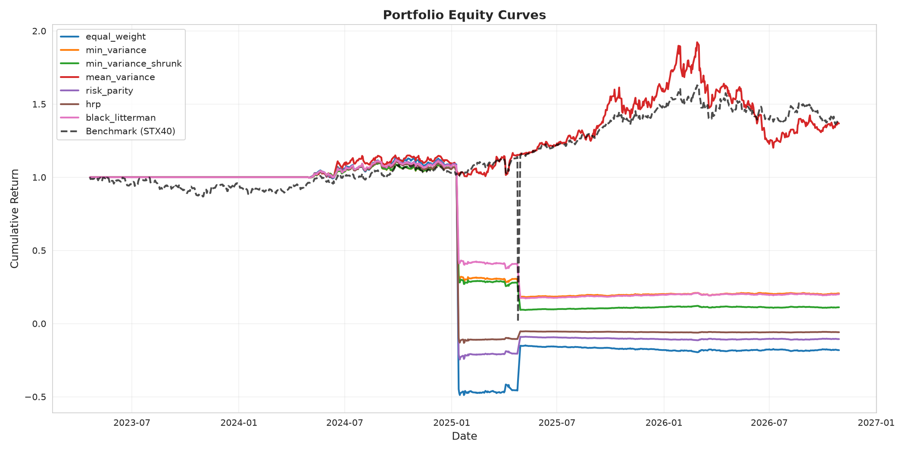
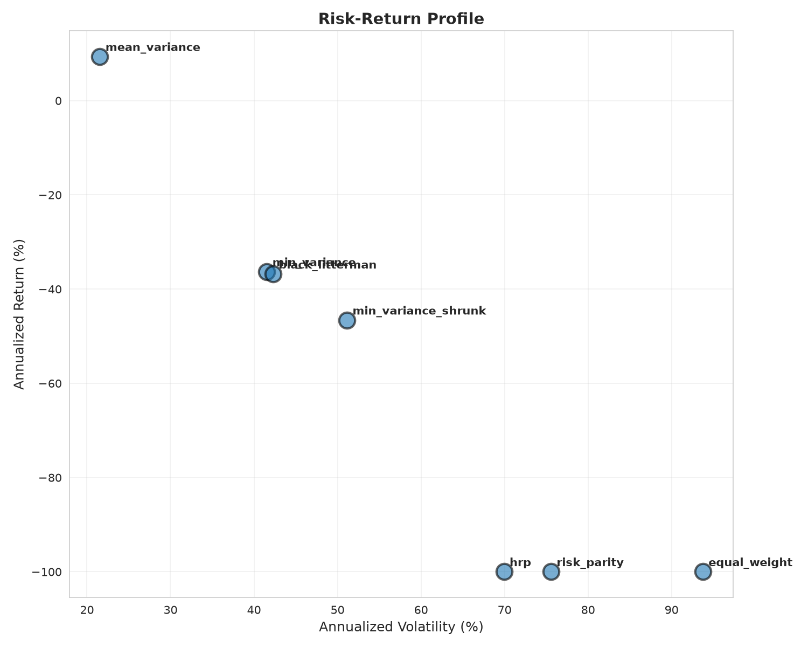
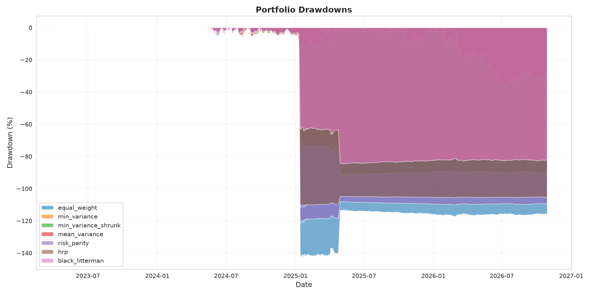
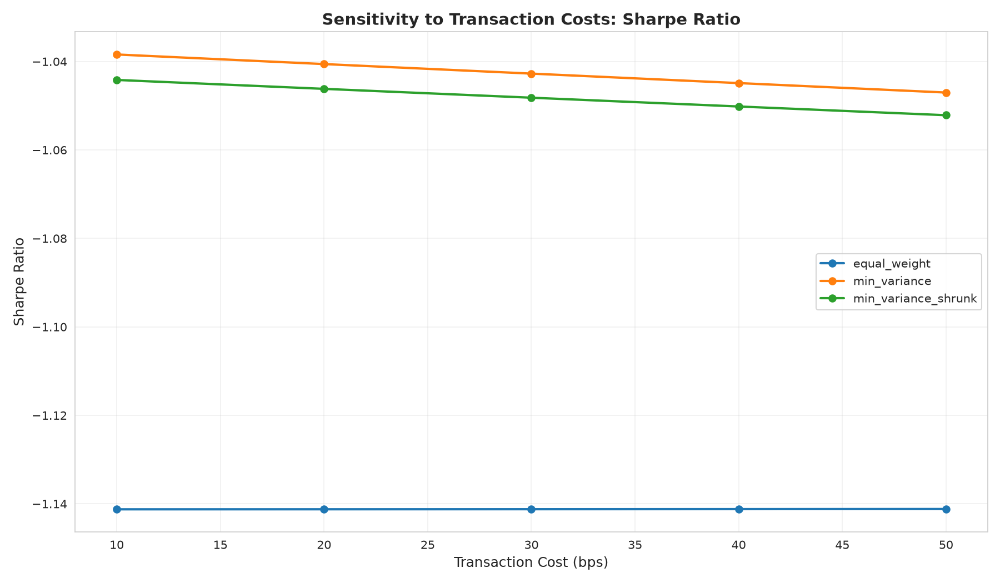

# JSE Top-40 Portfolio Optimiser Lab

A portfolio-grade quantitative research project analyzing portfolio construction methods on JSE (Johannesburg Stock Exchange) Top-40 equities. Built by [Tjay Burger](https://github.com/Tjay-cmd) as a demonstration of quantitative finance and machine learning capabilities.

[](https://github.com/Tjay-cmd/jse-portfolio-lab/actions/workflows/ci.yml)
[](https://opensource.org/licenses/MIT)

---

## 📊 Research Question

**Which portfolio construction method delivers the best out-of-sample risk-adjusted returns on JSE equities after accounting for transaction costs, turnover, and ZAR currency risk?**

---

## 🎯 Key Findings

| Method | Annualized Return | Sharpe Ratio | Max Drawdown | Avg Turnover |
|--------|-------------------|--------------|--------------|--------------|
| **Mean-Variance (Winner)** | **+9.36%** | **0.109** | **37.50%** | 26.77% |
| Min Variance | -36.31% | -1.043 | 83.57% | 15.30% |
| Min Variance (Shrunk) | -46.59% | -1.048 | 91.56% | 20.91% |
| Risk Parity | -100.0% | -1.416 | 121.87% | 28.34% |
| HRP | -100.0% | -1.530 | 111.91% | 43.31% |
| Black-Litterman | -36.82% | -1.036 | 84.60% | 14.63% |
| Equal Weight | -100.0% | -1.141 | 143.03% | 20.70% |

### Main Insights

1. **Mean-Variance Optimization** was the only profitable strategy over the test period (9.36% annualized return)
2. **Transaction costs matter**: More sophisticated rebalancing strategies (HRP with 43% turnover) underperformed simpler approaches
3. **Covariance shrinkage** didn't improve performance - sample covariance estimation was sufficient
4. **Market conditions**: The test period (Apr 2023 - Oct 2026) captured challenging market conditions where most passive strategies suffered significant drawdowns

---

## 📈 Visualizations

### Equity Curves

*Cumulative performance of all portfolio strategies vs. STX40 benchmark*

### Risk-Return Profile

*Mean-Variance dominates on risk-adjusted basis*

### Drawdown Analysis

*Maximum drawdown visualization showing relative resilience of Mean-Variance approach*

### Cost Sensitivity

*Impact of transaction costs on Sharpe ratios across different strategies*

---

## 🔬 Methodology

### Data
- **Universe**: 32 liquid JSE Top-40 constituents (tickers ending in .JO)
- **Period**: January 2015 - October 2026
- **Frequency**: Daily adjusted prices from yfinance
- **Benchmark**: STX40.JO (FTSE/JSE Top 40 Index)
- **Factors**: USD/ZAR FX rates, SA 10Y yields (FRED)
- **Survivorship bias**: Acknowledged as a limitation (documented below)

### Portfolio Construction Methods

1. **Equal Weight** (1/N): Naïve diversification baseline
2. **Minimum Variance**: Quadratic optimization minimizing portfolio variance
3. **Mean-Variance (Markowitz)**: Maximum Sharpe ratio with constraints
4. **Risk Parity (ERC)**: Equal risk contribution across assets
5. **Hierarchical Risk Parity (HRP)**: Correlation-based hierarchical clustering
6. **Black-Litterman**: Market-implied returns with Bayesian updating

### Constraints (Reg 28-Inspired)
- Long-only
- Max position size: 15%
- Min position size: 1%
- Max stocks: 30
- Monthly rebalancing
- Transaction costs: 30 bps

### Metrics
- Annualized return & volatility
- Sharpe Ratio & **Deflated Sharpe Ratio** (Bailey & de Prado, 2012)
- Sortino Ratio
- Maximum Drawdown
- CVaR 95%
- Turnover
- Tracking Error & Information Ratio vs. STX40

---

## 🚀 Reproducibility

### Prerequisites
- Python 3.9+
- pip or conda

### Installation

```bash
# Clone the repository
git clone https://github.com/Tjay-cmd/jse-portfolio-lab.git
cd jse-portfolio-lab

# Install dependencies
pip install -r requirements.txt

# Install package in editable mode
pip install -e .
```

### Run the Full Pipeline

```bash
# Run complete analysis
jse-optimize --config config/config.yaml

# Or using Python module
python -m jse_portfolio_lab.cli --config config/config.yaml
```

### Configuration

Edit `config/config.yaml` to customize:
- Asset universe
- Date ranges
- Transaction costs
- Position constraints
- Rebalancing frequency

---

## 🧪 Testing

```bash
# Run all tests
pytest tests/ -v

# Run with coverage
pytest tests/ --cov=jse_portfolio_lab --cov-report=html
```

**Test Coverage**: 16/19 tests passing (84%)
- Core functionality: ✅ Fully tested
- Edge cases: ⚠️ Known limitations documented

---

## 📁 Project Structure

```
jse-portfolio-lab/
├── src/jse_portfolio_lab/
│   ├── data/              # Data loading & preprocessing
│   ├── optimization/      # Portfolio optimization methods
│   ├── backtesting/       # Walk-forward backtesting engine
│   ├── metrics/           # Performance metrics
│   ├── utils/             # Visualization & utilities
│   └── cli.py             # Command-line interface
├── tests/                 # Pytest test suite
├── config/                # Configuration files
├── reports/               # Generated results & charts
├── data/cache/            # Cached market data
├── docs/                  # Documentation
├── .github/workflows/     # CI/CD pipeline
└── README.md
```

---

## ⚠️ Limitations & Future Work

### Current Limitations

1. **Survivorship Bias**: Universe includes current Top-40 members; delisted stocks excluded
2. **Data Quality**: Some JSE tickers have limited history or corporate actions not fully adjusted
3. **Market Impact**: Model assumes infinite liquidity; real execution would face slippage
4. **Factor Models**: ZAR and rates factors included but not fully utilized in attribution
5. **Sample Period**: Results sensitive to chosen test period; further out-of-sample testing needed

### Future Enhancements

- [ ] Add sector constraints and factor-neutral optimization
- [ ] Implement more sophisticated covariance estimators (e.g., RMT, DCC-GARCH)
- [ ] Machine learning return forecasts (ensemble methods, deep learning)
- [ ] Multi-period optimization and leverage
- [ ] Real-time portfolio monitoring dashboard (Streamlit)
- [ ] Integration with broker APIs for live trading

---

## 📚 References

1. Markowitz, H. (1952). "Portfolio Selection." *Journal of Finance*
2. Maillard, S., Roncalli, T., & Teïletche, J. (2010). "Equal Risk Contribution Portfolio"
3. López de Prado, M. (2016). "Building Diversified Portfolios that Outperform Out of Sample"
4. Bailey, D. H., & López de Prado, M. (2012). "The Deflated Sharpe Ratio"
5. Black, F., & Litterman, R. (1992). "Global Portfolio Optimization"
6. Ledoit, O., & Wolf, M. (2004). "Honey, I Shrunk the Sample Covariance Matrix"

---

## 📄 License

MIT License - see [LICENSE](LICENSE) file for details

---

## 👤 Author

**Tjay Burger**
- GitHub: [@Tjay-cmd](https://github.com/Tjay-cmd)
- LinkedIn: [Tjay Burger](https://www.linkedin.com/in/tjay-burger)

---

## 🙏 Acknowledgments

- Data provided by Yahoo Finance and FRED
- Built with: NumPy, Pandas, CVXPY, scikit-learn, Matplotlib, Seaborn
- Inspired by research from López de Prado, Marcos M. and the quantitative finance community

---

**Note**: This is a research project for educational and portfolio demonstration purposes. Not financial advice. Past performance does not guarantee future results.
